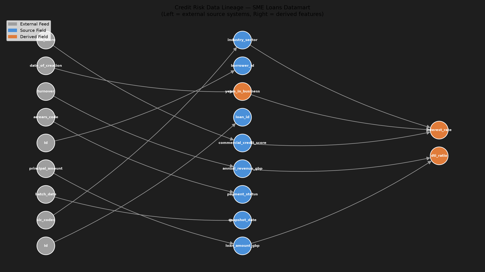
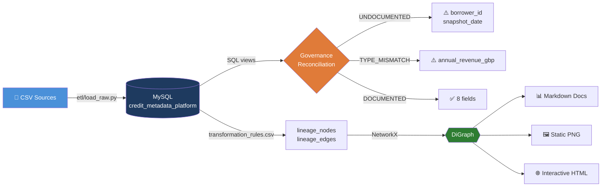
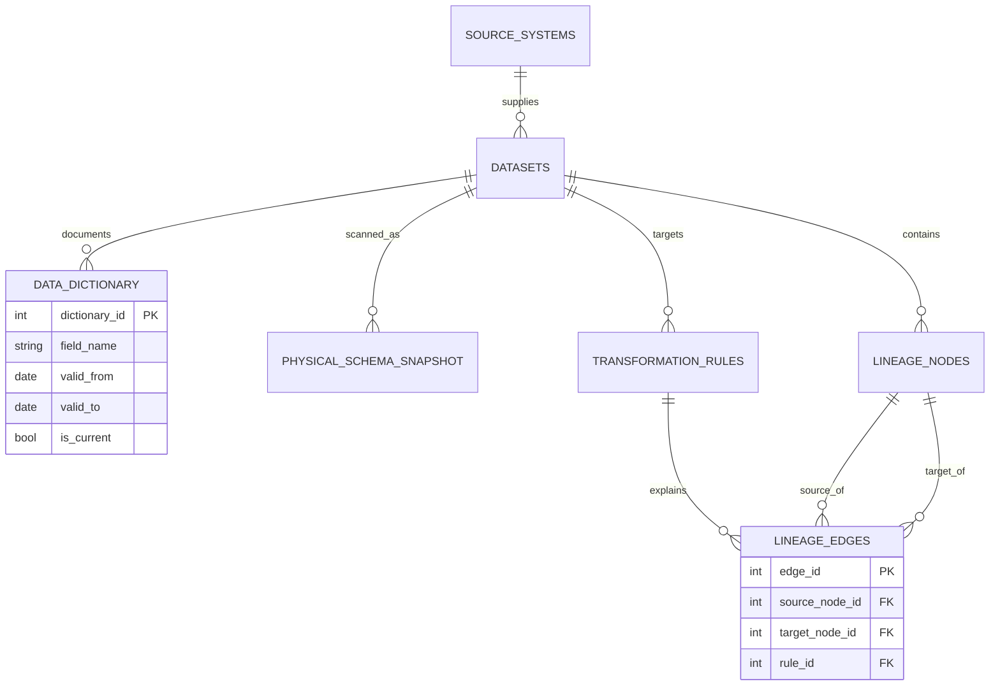

<div align="center">


<a href="#">
  
</a>

<br/>


</div>

---

## What this is

A metadata governance and data lineage platform for a credit risk datamart. It answers the
three questions a bank's model-risk and audit functions actually ask about any data asset:

<table>
<tr>
<td width="33%" align="center">

**🔍 Is our documentation<br/>accurate?**

Dictionary vs. physical<br/>schema reconciliation

</td>
<td width="33%" align="center">

**🕰️ What did a field mean<br/>on a given date?**

Versioned (SCD2)<br/>business definitions

</td>
<td width="33%" align="center">

**🧬 Where does this number<br/>come from?**

Field-level<br/>data lineage graph

</td>
</tr>
</table>

> **Scope note:** this is metadata governance and lineage, not data quality. No null checks,
> drift detection, or duplicate analysis here — that's a separate, companion project.

<div align="center">

<br/><sub>Static lineage render · <a href="docs/lineage_graph_interactive.html">open the interactive version</a> to hover any node</sub>
</div>

---

## Pipeline flow



## Entity relationship model



---

## Architecture

```
credit-metadata-lineage-platform/
├── sql/
│   ├── ddl/
│   │   ├── 01_create_schema.sql        # 8-table normalized (3NF) schema
│   │   └── 03_audit_triggers.sql       # DB-level audit logging triggers
│   └── validation/
│       ├── 02_dictionary_reconciliation.sql   # governance reconciliation views
│       └── run_validation.py                  # governance report + audit logging
├── etl/
│   └── load_raw.py                     # source registry, dictionary load, physical load
├── metadata/
│   └── dictionary_service.py           # SCD2 versioning service for business definitions
├── lineage/
│   ├── load_transformation_rules.py    # transformation_rules.csv -> graph tables
│   ├── build_graph.py                  # MySQL -> networkx.DiGraph, traversal utilities
│   └── visualize.py                    # static PNG + interactive HTML rendering
├── docs/
│   ├── templates/                      # Jinja2 templates
│   ├── generate_docs.py                # renders data_dictionary.md + lineage_report.md
│   └── *.md / *.png / *.html           # generated output (checked in for review)
├── config/
│   ├── db_config.py                    # SQLAlchemy engine factory
│   └── .env.example                    # credential template
├── data/raw/                           # source CSVs
└── main.py                             # pipeline orchestrator
```

The dictionary is versioned rather than overwritten — a definition change closes the old row
(`valid_to`, `is_current=0`) and inserts a new one, so "what did this field mean on the date a
credit decision was made" is always answerable. Every insert/close of a dictionary row is
captured automatically by database-level triggers, not application code, so the audit trail
can't be bypassed.

---

## 📊 What it actually found in this dataset

Running the pipeline against the sample SME loans datamart surfaces real governance issues,
not synthetic examples:

| Finding | Detail |
|---|---|
| 🔴 2 undocumented columns | `borrower_id`, `snapshot_date` exist in the physical table but have no dictionary entry |
| 🟡 1 type mismatch | `annual_revenue_gbp` is documented as `integer` but landed as `double` in MySQL — a single missing value forced a pandas dtype upcast during load |
| 🔵 1 documented redefinition | `commercial_credit_score`'s bureau scoring methodology changed on 2024-04-02 (0–100 scale → 1–30 risk-tier scale); lineage traversal proves `interest_rate` is the only downstream field affected |
| ✅ 72.7% documentation coverage | Computed live from `vw_governance_scorecard`, not hand-counted |

---

## 🚀 Setup

<details>
<summary><b>Prerequisites</b></summary>
<br/>

- MySQL 8.0+
- Python 3.10+
</details>

<details>
<summary><b>1️⃣ One-time infrastructure setup</b></summary>
<br/>

Schema creation and user provisioning are one-time DBA-level steps, kept separate from the
repeatable pipeline (`main.py`) — this mirrors how schema changes go through separate change
control from application deploys in a real banking environment.

```bash
# Create schema
mysql -u root -p < sql/ddl/01_create_schema.sql

# Create an application user (least-privilege, not root)
mysql -u root -p -e "
  CREATE USER 'metadata_platform_user'@'localhost' IDENTIFIED BY 'your_password_here';
  GRANT ALL PRIVILEGES ON credit_metadata_platform.* TO 'metadata_platform_user'@'localhost';
  FLUSH PRIVILEGES;"

# Create governance views
mysql -u root -p credit_metadata_platform < sql/validation/02_dictionary_reconciliation.sql

# Install audit triggers (also revokes DELETE on the app user)
mysql -u root -p credit_metadata_platform < sql/ddl/03_audit_triggers.sql
```
</details>

<details>
<summary><b>2️⃣ Python environment</b></summary>
<br/>

```bash
pip install -r requirements.txt
cp config/.env.example config/.env
# edit config/.env with the credentials created above
```
</details>

<details>
<summary><b>3️⃣ Run the pipeline</b></summary>
<br/>

```bash
python3 main.py
```
Runs, in order: ETL load → governance validation → lineage extraction → documentation
generation → visualization. Every stage is idempotent — safe to re-run any time.
</details>

<details>
<summary><b>4️⃣ Explore the output</b></summary>
<br/>

| File | What it shows |
|---|---|
| `docs/data_dictionary.md` | Field reference, governance status, SCD2 version history |
| `docs/lineage_report.md` | Full upstream/downstream traces, rule registry |
| `docs/lineage_graph.png` | Static lineage diagram |
| `docs/lineage_graph_interactive.html` | Open in a browser; hover any node |

```bash
python3 metadata/dictionary_service.py   # demonstrates SCD2 versioning end-to-end
```
</details>

---

## 🧠 Skills demonstrated

- **Database design** — normalized (3NF) schema, SCD Type 2 dimensional modeling, database-level
  audit triggers, least-privilege access control
- **SQL** — `FULL OUTER JOIN` emulation via `UNION` (MySQL has no native support), governance
  scorecard views, point-in-time temporal queries
- **ETL** — idempotent, re-runnable load pipeline with SQLAlchemy
- **Metadata governance** — automated dictionary-vs-reality reconciliation, versioned business
  definitions, point-in-time definition lookup for audit
- **Data lineage** — graph modeling in NetworkX, ancestor/descendant traversal, DAG validation,
  two independent visualization renderers
- **Documentation as code** — Jinja2-templated Markdown generated directly from governed tables

---

## 🐛 Real bugs found and fixed while building this

Left in as documentation, not removed — each one is a genuine, non-obvious issue caught by
actually running the code against a live database rather than trusting it on inspection.

<details>
<summary><b>Show all 8</b></summary>
<br/>

1. **MySQL 8.0.13+ syntax** — non-literal `DEFAULT` expressions must be wrapped in parentheses
   (`DEFAULT (CURRENT_USER())`, not `DEFAULT CURRENT_USER()`).
2. **pandas → PyMySQL NaN binding** — blank CSV cells become float `NaN`, which PyMySQL's
   parameter binder rejects outright rather than treating as NULL.
3. **`pd.read_sql` NULL handling** — SQL `NULL` comes back as float `NaN` in mixed-type columns,
   breaking both string formatting and JSON serialization (`json.dumps` emits an invalid `NaN`
   token that MySQL's `JSON` column type rejects).
4. **MySQL `REVOKE` scope matching** — a privilege revoke must match the scope it was granted at.
5. **MySQL triggers have no `SQL SECURITY INVOKER` option** (only views/procedures do) — triggers
   always run in definer context, so `CURRENT_USER()` inside a trigger returns the trigger's
   *creator*, not the caller. Fixed with `USER()` instead.
6. **In-memory-only deduplication** — a loader that deduped against a dict built during the
   current run (not the database) silently duplicated every row on a second run. Fixed with a
   `SELECT`-before-`INSERT` check plus a database-level `UNIQUE` constraint.
7. **Arrowheads swallowed by node markers** — matplotlib's default edge rendering terminates the
   arrowhead behind the node marker. Fixed with `min_source_margin` / `min_target_margin`.
8. **pyvis local asset path** — default `cdn_resources="local"` writes a `lib/` folder relative
   to the script's *working directory*, not the output file's directory, silently breaking the
   HTML when opened elsewhere. Fixed with `cdn_resources="remote"`.

</details>

---

## Not in scope

Data quality monitoring (null/missing value checks, statistical drift detection, duplicate
detection) is intentionally out of scope — this project is metadata and lineage governance,
not data quality. See the companion Data Quality Monitoring project for that.

<div align="center">

</div>
