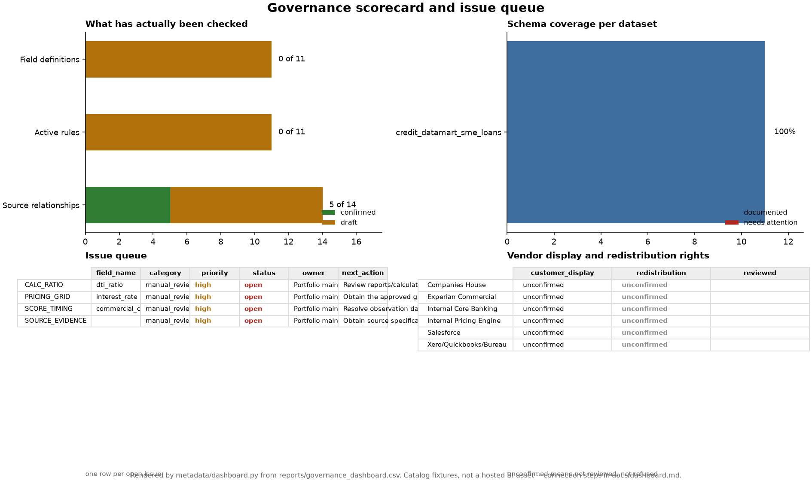

# Governance dashboard

Three things ship here, and only two of them are generated:

| File | What it is |
|---|---|
| [`reports/governance_dashboard.csv`](../reports/governance_dashboard.csv) | The extract. One long table — `section, subject, metric, value` — that a BI tool reads |
| [`docs/governance_dashboard.png`](governance_dashboard.png) | A preview of that table, drawn by `metadata/dashboard.py` in step 6/6 of `main.py` |
| this file | The connection and layout spec, and the limits of what may be claimed |

## Why there is no Power BI or Tableau link to click

A hosted dashboard needs an account, a data-source credential and a refresh path.
This project has none of the three. A screenshot of a service nobody can reproduce
is a claim, not an artifact, so it is not shipped. What is shipped instead is the
half that a reviewer can actually check: a tidy extract that any of the three tools
opens without a connector, and a preview rendered from those same rows on the same
machine as every other report.

The image above is the layout this spec describes, rendered by matplotlib. Build the
real thing from the CSV and it should look like the image. If it does not, either the
extract or the layout drifted, and the integration test that byte-compares the
committed CSV is the one to blame.

## The extract is long, not wide

`section, subject, metric, value` — 52 rows:

| `section` | `subject` | one row per | source |
|---|---|---|---|
| `scorecard` | dataset name | scorecard column | `vw_governance_scorecard` |
| `verification` | object type | status count | `field_verification`, `transformation_rules`, `lineage_edges` |
| `issues` | `issue_key` | issue attribute | `governance_issues` |
| `vendors` | vendor name | use restriction | `vendor_usage` |

Long on purpose. A BI tool pivots rows; a wide table with one column per KPI is
already a report, and a report is not a data source. Pivoting `metric` across
`value` in the tool gives the wide table back in one step, which is what a scorecard
visual wants, and adding a fifth section later does not change the schema.

There are no timestamps. `opened_at` and `updated_at` would make the committed extract
disagree with itself on the next run, and "the committed report cannot quietly
disagree with the code that wrote it" outranks "the dashboard shows when it was
refreshed". Queue timing lives in the gitignored `reports/local/` exports.

## Connect it

All three read a CSV in the repository, so the difference is the refresh story.

**Power BI Desktop** — *Get data → Text/CSV*, pick
`reports/governance_dashboard.csv`, then *Transform data*: set `value` to Text (some
metrics are counts, some are labels; a single type that loses nothing is Text, and the
measures below coerce). Load, then create the pivot: `section` and `metric` as legend,
`value` summed after a `COUNTA`-style coercion, `subject` on rows. Refresh works only
while this machine can reach the file — *File → Options → Data source settings* is
where you change that path. There is no Power BI Service publication here.

**Looker Studio** — *Add data → File → CSV*, upload the same file. In the data source,
mark `value` as *Number* only if you filter to `section = "scorecard"` first; for the
mixed table keep it as *Text* and let the table render it. Add a *Filter control* on
`section` and one on `subject`. A connector to MySQL (instead of the CSV) is the
correct production answer — the CSV is a snapshot and does not refresh itself.

**Tableau Public** — *Connect → Text file*, drag `value` to Measure Values only after
creating `VALUE_NUM` = `IF ISNULL([value]) THEN 0 ELSE FLOAT([value]) END`. Free by
default; publishing to Tableau Public makes every row on that sheet world-readable,
which is fine for catalog fixtures and would not be for real loan data.

Whichever tool: keep `section` as the primary filter, never as a page. The four
sections have different natural visual types.

## Layout

Four panels, the same four the preview draws:

- **What has actually been checked** — stacked bar, one bar per verification object
  (`Field definitions`, `Active rules`, `Source relationships`), `confirmed` against
  `draft`. Annotate each bar with `confirmed of total`. This is the panel the whole
  project exists to make visible.
- **Schema coverage per dataset** — stacked bar, `documented` against
  `undocumented + type_mismatch + deprecated`, labelled with the coverage percentage.
  Title it coverage, never quality.
- **Issue queue** — table: `issue_key` as rows, `field_name`, `category`, `priority`,
  `status`, `owner`, `next_action` as columns. Colour `status` and `priority` from the
  vocabulary in `metadata/dashboard.py::STATUS_COLOURS`. Make it a drillthrough from
  any count of open issues.
- **Display and redistribution rights** — table on `vendor_name` with
  `customer_display`, `redistribution`, `reviewed`. `unconfirmed` renders grey, not
  red: it means nobody reviewed it, which is not the same answer as *prohibited*.

Interactions worth adding once the panels exist: filter the two tables by `owner`, and
highlight the issue row when a verification bar is selected. Neither changes a number.

## Refresh

`python main.py` rewrites both files from MySQL in step 6/6; `python -m
metadata.dashboard` does the same on its own against the configured database.
A scheduled refresh of the real thing would point the tool at the database rather
than at the CSV, because the CSV is only current until the pipeline next runs.

Two guards exist so the preview cannot rot silently: the committed CSV is compared
byte-for-byte with what the current catalog regenerates, and the PNG is rendered twice
in one run and must agree with itself and with the committed file. Raster output only
ever matches the machine that drew it, so the committed PNG is regenerated, not
argued with, when the layout changes.

## What this dashboard does not say

- 100% coverage is not 100% verified. The scorecard measures documented and
  type-aligned physical columns; every field definition is still `draft`.
- No time series. There is no history table behind the extract, so a trend line would
  be decoration.
- The committed extract has one dataset because it came from a fresh install plus one
  pipeline run. `python -m etl.load_market_prices` adds
  `market_close_prices_daily` to `vw_governance_scorecard`, and the next run then adds
  its rows; no market values are committed, because the redistribution right is
  unconfirmed.
- Every figure comes from catalog fixtures. Nothing here is a live governance state
  for a real institution.
